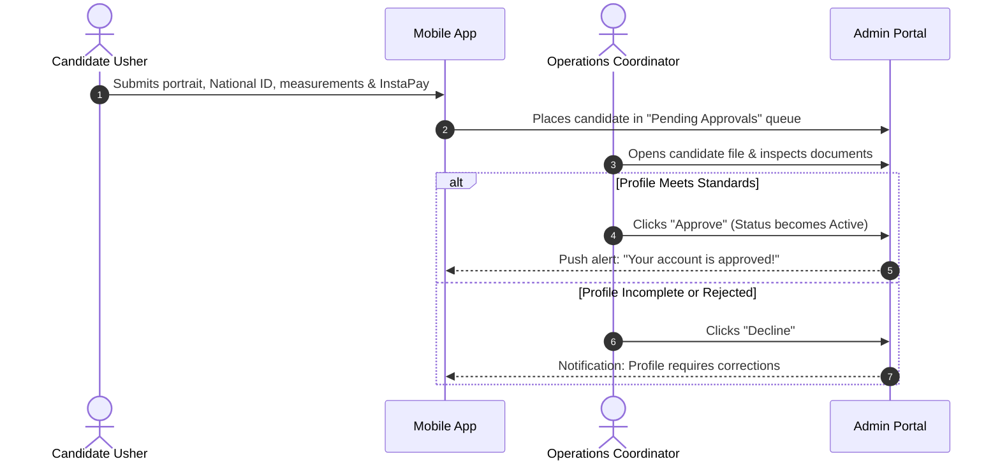

# INSIDERS — Event Operations Command Center
## Comprehensive Administrator & Operations Manual

> **Document Version:** 3.0.0 (Non-Technical Operational Edition)  
> **Audience:** Event Directors, Operations Managers, Floor Supervisors & Staffing Coordinators  
> **Language:** English  
> **Scope:** Complete Step-by-Step Platform Usage, Field Workflows & Incident Handling  

---

## Table of Contents
1. [Introduction & Platform Overview](#1-introduction--platform-overview)
2. [Getting Started: Logging In & Account Access](#2-getting-started-logging-in--account-access)
3. [User Roles & Permissions (Who Can Do What)](#3-user-roles--permissions-who-can-do-what)
4. [Executive Dashboard & Live Activity Monitoring](#4-executive-dashboard--live-activity-monitoring)
5. [Managing Ushers: Onboarding, Vetting & Approvals](#5-managing-ushers-onboarding-vetting--approvals)
6. [Creating & Configuring Events](#6-creating--configuring-events)
7. [Staff Allocation, Operational Zones & Team Leads](#7-staff-allocation-operational-zones--team-leads)
8. [Live Event Day Execution: Attendance & Selfie Verification](#8-live-event-day-execution-attendance--selfie-verification)
9. [Uniform & Wardrobe Logistics (Automated Sizing Summary)](#9-uniform--wardrobe-logistics-automated-sizing-summary)
10. [Lateness Policies, Deductions & Disciplinary Suspensions](#10-lateness-policies-deductions--disciplinary-suspensions)
11. [Real-Time Staff Communication & Mobile Announcements](#11-real-time-staff-communication--mobile-announcements)
12. [Financial Management, Payouts & InstaPay Disbursements](#12-financial-management-payouts--instapay-disbursements)
13. [Exporting Branded Excel Payroll Sheets & Printable PDF Rosters](#13-exporting-branded-excel-payroll-sheets--printable-pdf-rosters)
14. [Client Feedback Loop & Quality Ratings](#14-client-feedback-loop--quality-ratings)
15. [Administrative Audit Log & Accountability](#15-administrative-audit-log--accountability)
16. [Operational Incident Response Guide (Every Real-World Scenario)](#16-operational-incident-response-guide-every-real-world-scenario)
17. [Standard Event Operations Checklist](#17-standard-event-operations-checklist)

---

## 1. Introduction & Platform Overview

**INSIDERS** is an all-in-one digital operations command system designed specifically for premier event staffing, VIP protocol management, and crowd coordination.

As an administrator or event coordinator, this system gives you complete, real-time command over:
- Vetting and approving event staff and inspecting their legal documents and uniform sizes.
- Creating single-day or multi-day shifts with precise geographic check-in boundaries.
- Assigning staff to specific functional teams (e.g., VIP Protocol, Registration, Media, Gates).
- Verifying on-site physical presence with mandatory GPS verification and live uniform selfie photos.
- Automating wardrobe requirements before shift start.
- Enforcing discipline, punctuality penalties, and temporary suspensions.
- Instant 1-click exports of publication-ready Excel payroll sheets with integrated InstaPay payment links.
- Gathering post-event client ratings to continuously grade staff reliability.

---

## 2. Getting Started: Logging In & Account Access

### 2.1 Logging into the Portal
1. Open your web browser (Google Chrome, Microsoft Edge, or Safari) and go to the web address provided by your organization.
2. The **Sign In** screen will appear.
3. Enter your **Work Email** and **Password**.
4. Click **"Sign In to Command Center"**.
5. Once authenticated, you will be taken directly to the **Operations Dashboard**.

### 2.2 Inviting a New Coordinator to Join the Admin Team
Only **Super Administrators** can invite new team members to access the dashboard.
1. Click **Settings** (gear icon) on the left sidebar navigation.
2. Select the **"Admin Management"** tab.
3. Click the **"Generate Invite Link"** button.
4. The system produces a secure, single-use web link.
5. Click **"Copy Link"** and send it privately to the new coordinator.
6. When the new coordinator opens the link:
   - They enter their Full Name, Email, and choose their private Password.
   - Upon clicking **"Register Account"**, their access is immediately active.
   - The invitation link expires automatically once used to prevent unauthorized access.

### 2.3 What to Do If You Forget Your Password
If an administrator or coordinator forgets their password, they must contact a **Super Administrator**. The Super Admin can reset their access credentials or generate a fresh access link directly from the settings panel.

---

## 3. User Roles & Permissions (Who Can Do What)

To keep operations secure and organized, the system divides administrative responsibilities into three distinct access levels:

```
┌────────────────────────────────────────────────────────────────────────┐
│                        ADMINISTRATIVE ACCESS TIERS                     │
├───────────────────────────────┬────────────────────────────────────────┤
│ 👑 Super Administrator         │ • Complete control over all features   │
│                                │ • Full financial management & payouts  │
│                                │ • Can invite/remove other admins       │
│                                │ • Can suspend/unsuspend ushers         │
│                                │ • Can view immutable system audit logs │
├───────────────────────────────┼────────────────────────────────────────┤
│ 💼 Finance Manager            │ • Full access to Financials & Wallets  │
│                                │ • Can approve & disburse cash payouts  │
│                                │ • Can export Excel payroll sheets      │
│                                │ • View-only for event shifts           │
├───────────────────────────────┼────────────────────────────────────────┤
│ 📋 Operations Coordinator     │ • Creates, schedules & publishes events│
│                                │ • Vets & approves new usher accounts   │
│                                │ • Assigns ushers to zones & teams      │
│                                │ • Audits live check-ins & selfies      │
│                                │ • Sends push announcements to staff    │
│                                │ • Downloads PDF field rosters          │
│                                │ ✗ Restricted from viewing wallet balances│
└───────────────────────────────┴────────────────────────────────────────┘
```

---

## 4. Executive Dashboard & Live Activity Monitoring

The **Dashboard** is the first screen you see after logging in. It gives you a birds-eye view of your entire organization’s staffing operations.

### Key Metric Cards:
- **Active Ushers:** Total count of verified, approved staff members ready for deployment.
- **Pending Approvals:** Highlights in red how many new usher applicant files are waiting for your review. Clicking this card takes you directly to the approval queue.
- **Active Events:** Number of upcoming, published, or ongoing events.
- **Check-in Rate:** Global percentage of confirmed staff who have successfully checked in on-site for today's active shifts.

### Time Filtering:
- Use the **Month Selector** dropdown at the top right to switch between **All Time** or a specific month (e.g., *October 2026*).
- All statistics, completion rates, and event volume trends will automatically recalculate for that chosen period.

### 6-Month Operations Trend:
- A visual bar chart comparing **Total Events Created** against **Successfully Completed Events**, helping management track monthly agency growth.

---

## 5. Managing Ushers: Onboarding, Vetting & Approvals

Every usher who downloads the mobile app must submit their professional profile before they are allowed to apply for or work at any event.



### 5.1 How to Review and Approve an Usher
1. In the left navigation menu, click **"Ushers"**.
2. Set the status filter dropdown to **"Pending"**.
3. Click the **Eye icon** or click the candidate's name to open their full profile dossier.
4. **Inspect the following details thoroughly:**
   - **Portrait Photo:** Confirm the face is clearly visible, well-lit, and suitable for VIP client presentation.
   - **National ID & Documents:** Check that the uploaded ID card is legible and matches their registered legal name and birthdate.
   - **Apparel Measurements:** Verify their sizes for *T-Shirt, Formal Shirt, Pants/Trousers, Shorts, and Shoes*.
   - **Language Skills:** Review languages spoken (e.g., Arabic, English, French).
   - **Payment Credentials:** Confirm their InstaPay handle (e.g., `username@instapay`) or mobile cash wallet number.
5. If everything looks good, click the green **"Approve"** button in the top right header. The usher is now `Active` and will instantly receive a notification on their phone.
6. If the profile is fraudulent or fails agency standards, click **"Decline"**.

### 5.2 Searching & Filtering Ushers
- Use the **Search bar** on the Ushers screen to quickly find any staff member by **Full Name**, **Phone Number**, or **Email**.
- Filter by status: `Active`, `Pending`, `Suspended`, or `Declined`.

### 5.3 Exporting the Usher Database
- Click the **"Export CSV"** button at the top right of the Ushers screen.
- A spreadsheet will download immediately containing contact info, total completed events, average star ratings, payment details, and uniform measurements for all filtered staff.

---

## 6. Creating & Configuring Events

To create a new staffing assignment, click **"Events"** in the sidebar, then click **"+ Create Event"**.

```
┌────────────────────────────────────────────────────────────────────────┐
│                        EVENT CREATION BUILDER                          │
├────────────────────────────────────────────────────────────────────────┤
│ 📍 STEP 1: VENUE & ARRIVAL GEOFENCE                                    │
│   • Search location or choose from popular Egyptian venues             │
│   • Drag the map pin to the exact staff entrance                       │
│   • Select Arrival Radius: [50m] [100m] [150m] [250m] [500m] [1000m]   │
├────────────────────────────────────────────────────────────────────────┤
│ 📅 STEP 2: SCHEDULE & DURATION                                         │
│   • Start Date & Time  ───────▶  End Date & Time                       │
│   • The system auto-calculates total working days for multi-day events │
│   • Set Check-in Window: How many minutes before call time check-in opens│
├────────────────────────────────────────────────────────────────────────┤
│ 💰 STEP 3: COMPENSATION & POLICIES                                     │
│   • Team Lead Daily Pay Rate (e.g., 1,200 EGP / day)                   │
│   • Regular Usher Daily Pay Rate (e.g., 1,000 EGP / day)               │
│   • Dress Code Specifications (e.g., "Black Suit, White Shirt, Tie")   │
│   • Operational Guidelines & Ground Instructions                       │
└────────────────────────────────────────────────────────────────────────┘
```

### Detailed Field Instructions:
1. **Event Title:** Give the event a clear, professional name (e.g., *"International Petroleum Conference — VIP Protocol"*).
2. **Venue Location & Map:**
   - Type in the venue search bar (e.g., *"Egypt International Exhibition Center"*).
   - Or choose from the popular venue shortcuts (*CICC, EIEC, El Gouna Arena, Grand Egyptian Museum, New Capital Sports City*).
   - An interactive map will appear. You can click and drag the pin to position it precisely at the **Staff Gate / Crew Entrance**.
3. **Geofence Radius Preset:**
   - This sets how close staff must physically be to the venue to check in.
   - **Recommended Settings:**
     - `50 meters`: Best for hotel ballrooms and indoor banquet halls.
     - `100 meters`: The standard setting for most exhibition centers and conference halls.
     - `250 meters – 500 meters`: Best for massive outdoor venues, sports stadiums, and beach clubs where parking is far away.
4. **Schedule & Shift Call Time:**
   - Choose **Start Date & Time** and **End Date & Time**.
   - If the shift spans several days, the platform automatically detects it as a multi-day event and calculates pay accordingly.
5. **Pay Rates (Differentiation):**
   - **Supervisor / Leader Rate:** Daily pay rate for appointed Team Leads.
   - **Regular Usher Rate:** Daily pay rate for standard team members.
6. **Dress Code & Instructions:**
   - Be as detailed as possible (e.g., *"Full Black Suit, Plain White Formal Shirt, Black Leather Shoes, Black Socks. No casual shoes, no facial jewelry"*).
   - This text will be prominently displayed on the ushers' mobile apps.
7. **Publishing the Event:**
   - Newly created events start in **Draft** status so you can configure teams privately.
   - When ready for ushers to see the event and apply, open the event and click **"Publish Event"**.

---

## 7. Staff Allocation, Operational Zones & Team Leads

Managing large events requires organizing staff into clear functional zones.

### 7.1 Creating Operational Teams / Zones
1. Open your event and click on the **"Staff & Teams"** tab.
2. In the **Teams column** on the left:
   - Enter a Team Name (e.g., *"VIP Stage"*, *"Registration Hall"*, *"Gate 3 Entrance"*, *"Airport Protocol"*).
   - Add specific instructions for that area (e.g., *"Meet at Gate 3 desk at 08:30 AM sharp"*).
   - Click **"Add"**.
3. You can create as many teams as your event structure requires.

### 7.2 Reviewing Applicants & Smart Sourcing
When an event is published, ushers can apply from their mobile app.
1. In the **Staff & Teams** tab, check the **Pending Applicants** section.
2. Use the **Candidate Filters** to find the right profiles:
   - **Gender:** Filter for Male or Female candidates.
   - **Languages:** Filter for specific language proficiencies (e.g., Fluent English or French).
   - **Minimum Star Rating:** Ensure staff meet your quality threshold (e.g., `4.5` stars or higher).
   - **Physical Specs:** Filter by Height (cm), Shirt size, or Shoe size.
3. Click **"Assign"** next to any approved candidate to immediately allocate them to the event.

### 7.3 Appointing a Team Lead
- Any regular usher can be promoted to a **Team Lead** with a single click.
- In the assigned staff list, find the member and click the **Crown icon**.
- **What happens automatically:**
  - Their title badge updates to **Team Lead**.
  - In the financial engine, their daily wage automatically increases to the **Leader Pay Rate**.
  - On the printable PDF roster, they are highlighted as the leader for on-ground security.

### 7.4 Setting Custom Pay Rates (Pay Overrides)
If you negotiated a special rate with a specific senior usher or talent:
- In the staff list, locate the usher’s row.
- Click on their pay amount box and type the custom total pay.
- The payroll engine will use this custom amount instead of the event’s standard rate.

---

## 8. Live Event Day Execution: Attendance & Selfie Verification

On the day of the event, INSIDERS protects your agency from ghost attendance and uniform violations through its **Dual-Factor Audit System**.

```
┌────────────────────────────────────────────────────────────────────────┐
│                     DUAL-FACTOR ATTENDANCE AUDIT                       │
├────────────────────────────────────────────────────────────────────────┤
│ FACTOR 1: SPATIAL & TEMPORAL (GPS GEOFENCE)                            │
│  • Staff mobile app reads satellite GPS coordinates                    │
│  • Must be within the venue radius (e.g., 100 meters)                  │
│  • Exact arrival timestamp logged (e.g., "08:52 AM — 8 mins early")   │
├────────────────────────────────────────────────────────────────────────┤
│ FACTOR 2: BIOMETRIC & DRESS CODE PROOF (LIVE SELFIE)                   │
│  • Mobile app forces camera capture (gallery uploads are blocked)      │
│  • Administrator inspects the high-resolution photo on dashboard       │
│  • Confirms correct individual is on-site and wearing required uniform │
└────────────────────────────────────────────────────────────────────────┘
```

### 8.1 How to Monitor Live Attendance
1. Open the active event page on your desktop, laptop, or tablet.
2. The **Attendance Summary** card shows live counters that update automatically:
   - **Total Assigned:** Total staff booked for today.
   - **Checked In:** Staff currently verified and standing on-site.
   - **Pending Applicants:** Waiting list candidates.
   - **Late / No-Show:** Staff who missed the designated arrival window.

### 8.2 Inspecting Check-in Details & Selfies
1. In the staff roster, find an usher who is marked as `Checked In`.
2. Click the **"Check-in Details"** button on their row.
3. A modal dialog opens showing:
   - **Check-in Timestamp:** Exact time they tapped check in.
   - **Lateness Count:** Calculated down to the minute (e.g., `0 mins` or `15 mins late`).
   - **Live Selfie Photo:** An enlarged, clear photograph taken by the usher at the moment of check-in.
4. **Audit Checklist:**
   - [ ] Does the face in the selfie match the registered profile avatar?
   - [ ] Are they wearing the mandated uniform (suit, tie, dress, badges)?
   - [ ] Does the background indicate they are actually inside the venue?

### 8.3 Performing a Manual Check-in (Emergency Field Override)
If an usher is standing in front of you, but their phone battery died, their camera has a cracked lens, or they have no internet data:
1. Confirm their identity and uniform in person.
2. In the staff list, find their name.
3. Click the menu dots `•••` on their row and select **"Manual Check-in"**.
4. The system immediately marks them as present.
5. This action is permanently logged in the **Audit Log** under your admin name for total transparency.

---

## 9. Uniform & Wardrobe Logistics (Automated Sizing Summary)

One of the biggest headaches in event management is manually messaging hundreds of ushers to tally uniform sizes. INSIDERS handles this automatically.

### Where to Find the Sizing Breakdown:
1. Open any event and look at the **"Sizes Summary"** card on the Overview tab.
2. The system automatically reads the profile measurements of **all currently assigned staff** and produces an instant aggregate headcount:
   - **T-Shirts:** `S (4) | M (18) | L (25) | XL (12) | XXL (3)`
   - **Formal Shirts:** `38 (6) | 40 (15) | 42 (20) | 44 (8)`
   - **Pants / Trousers:** `30 (8) | 32 (22) | 34 (15) | 36 (6)`
   - **Shorts / Skirts:** `M (10) | L (14)`
   - **Dresses:** `38 (4) | 40 (7)`
   - **Shoes:** `41 (5) | 42 (14) | 43 (18) | 44 (12) | 45 (4)`

### How to Use This in Operations:
- **3 Days Before Event:** Open the card and copy the exact quantities to send to your wardrobe manufacturer or uniform rental agency.
- **On Event Day:** When handing out uniform bags at the staff entrance, wardrobe teams have the exact counts ready without shortages.

---

## 10. Lateness Policies, Deductions & Disciplinary Suspensions

Maintain strict professionalism with clear, automated rules.

### 10.1 Automated Lateness Deduction Rules
1. In your event page, open the **"Deductions"** tab.
2. You can create automated financial penalty rules:
   - **Rule Name:** e.g., *"Late Arrival Penalty"*.
   - **Deduction Amount:** Flat fee (e.g., `50 EGP` or `100 EGP`).
   - **Trigger:** Set to automatically apply to any usher whose check-in timestamp is after the scheduled call time.

### 10.2 Adding a Manual Deduction (Ad-Hoc Penalty)
If an usher committed a behavioral infraction on ground (e.g., using personal smartphone during VIP reception, leaving their post early, or missing their tie):
1. Locate the usher in the staff roster.
2. Click the **"Deduct"** button on their row.
3. Enter the amount to deduct (e.g., `100 EGP`) and write the reason (e.g., *"Dress code infraction — missing blazer"*).
4. Click **"Apply Deduction"**.
5. The amount is immediately deducted from their shift earnings on the payroll sheet.

### 10.3 The Disciplinary Suspension Engine
For severe violations (such as skipping a shift without notice, showing up intoxicated, or harassing guests), apply a temporary or extended suspension:

```
┌────────────────────────────────────────────────────────────────────────┐
│                     DISCIPLINARY SUSPENSION PRESETS                    │
├────────────────────────────────────────────────────────────────────────┤
│  [ 1 Week ]   • For minor first-time unexcused lateness                │
│  [ 2 Weeks ]  • For late cancellation (under 12 hours before call time)│
│  [ 1 Month ]  • Standard penalty for unexcused No-Show                 │
│  [ 3 Months ] • For repeated unreliability or client complaints        │
│  [ 6 Months ] • For serious behavioral or safety violations            │
│  [ 1 Year ]   • Major agency misconduct                                │
│  [ Custom ]   • Select any specific end date and time                  │
└────────────────────────────────────────────────────────────────────────┘
```

#### How to Suspend an Usher:
1. Go to **Ushers** and open the member's profile page.
2. Click the red/orange **"Suspend"** button.
3. Choose one of the quick presets (e.g., **1 Month**) or pick a specific date.
4. Click **"Confirm Suspension"**.

#### What the System Does Automatically:
- Changes the usher’s status to `Suspended`.
- **Automatically revokes and cancels all their upcoming event assignments.**
- Locks their mobile app so they **cannot view or apply to any new events**.
- When the suspension period concludes, the system either re-enables them automatically or allows a Super Admin to click **"Unsuspend"**.

---

## 11. Real-Time Staff Communication & Mobile Announcements

Stop chasing staff across disorganized WhatsApp groups where critical messages get lost.

### 11.1 Event Announcement Chat (Shift Broadcast)
1. On the top navigation bar of any event, click the **Message/Chat icon**.
2. A slide-over drawer opens showing the event’s dedicated announcement feed.
3. Type your announcement (e.g., *"Attention all teams: VIP bus arriving at Gate 1 at 14:00. Floor supervisors take positions"*).
4. Click **"Send Broadcast"**.
5. **Result:**
   - Message appears immediately in the feed for all assigned staff.
   - An instant **Push Notification** is delivered directly to the lock screens of their mobile devices.

### 11.2 System-Wide Broadcasts (`/broadcasts`)
To message your entire agency roster at once (e.g., *"We are recruiting 80 ushers for next week's sports championship — open the app to apply"*):
1. Click **"Broadcasts"** on the left menu.
2. Type your message title and body.
3. Click **"Send Broadcast"**.
4. Every registered usher on the platform receives the notification.

---

## 12. Financial Management, Payouts & InstaPay Disbursements

The **Financials** hub gives finance managers and directors total command over digital wallets, payouts, and wage settlements.

### 12.1 Managing Digital Wallets (`Balances` Tab)
- Every time an usher completes a shift, their net wage (base salary minus any deductions) is credited to their in-app wallet.
- On the **Balances** tab, you can view the live balance of every staff member.
- **Adjust Balance Modal:** If an usher earned an extra bonus or needs an administrative adjustment:
  - Click **"Adjust Balance"**.
  - Choose **Credit** (add money) or **Debit** (subtract money).
  - Enter the amount and the administrative reason (e.g., *"Overtime bonus for 2 extra hours"*).

### 12.2 Processing Payout Requests (`Payouts` Tab)
Ushers can request withdrawal of their earnings through their mobile app:
1. Open **Financials** and click the **"Payouts"** tab.
2. A red badge highlights pending withdrawal requests.
3. For each request, you see:
   - Usher Name & Phone Number.
   - Requested Amount (e.g., `EGP 2,500.00`).
   - Payment Method: **InstaPay**, **Vodafone Cash**, or **Bank IBAN**.
   - Account details (e.g., `ushername@instapay`).
4. **Fast Transfer via InstaPay:**
   - Click the **QR Code icon** to display an InstaPay QR code on screen.
   - Scan with your corporate banking or InstaPay mobile app to transfer the money in seconds.
5. Click **"Mark as Paid"** and paste your bank transaction reference number.
6. The funds are deducted from the usher's wallet, and a confirmation push notification is sent to their phone.

---

## 13. Exporting Branded Excel Payroll Sheets & Printable PDF Rosters

INSIDERS produces publication-ready financial and operational documents with a single click.

### 13.1 Branded Excel Payroll Sheet
Inside any completed or active event, click the **"Export Salary"** button:
- Generates an official Excel sheet styled in the agency's Navy and Teal brand palette.
- **Section Separation:** Automatically divides staff into **Supervisors** and **Ushers**.
- **Calculated Columns:** Full Legal Name, Working Days, Daily Pay Rate, Applied Deductions, and Net Subtotal.
- **Dynamic Formulas:** Includes automated `SUM` formulas for accounting audit compliance.
- **Direct InstaPay Links:** Embeds clickable links next to each employee for 1-tap mobile banking transfers.

### 13.2 High-Resolution Printable PDF Usher Sheet
Inside any event, click the **"Export PDF"** button:
- Designed specifically for on-ground security desks and entrance checkpoints.
- **Large Portrait Photos (144px × 144px):** Razor-sharp, high-clarity portraits rendered at 2.5× DPI quality so gate security can immediately identify staff.
- **Roster Columns:** Full Legal Name, Phone Number, Assigned Team/Zone, Leader Role, and a **blank physical signature and notes box**.
- **Footer Sizing Summary:** Includes the uniform sizing summary at the bottom for quick warehouse reference.

---

## 14. Client Feedback Loop & Quality Ratings

Closing the loop with the client ensures quality control and continuous improvement.

### How to Send the Feedback Form to a Client:
1. When an event wraps up, click the green **"Complete & Process"** button at the top of the event page.
2. In the right-hand **"Rate Event Link"** card, click **"Generate Link"**.
3. Click the **Copy** icon to copy the private web address (e.g., `https://insiders.app/feedback/a8b9c7...`).
4. Send the link to the client, event organizer, or production director via WhatsApp or email.

### What the Client Sees:
- A sleek, branded evaluation form that works on any phone or computer without needing to log in.
- The client rates the overall event on a 1-to-5 star scale.
- Rates each operational team individually (e.g., VIP Protocol vs Registration).
- Submits overall comments and commendations.

### How it Affects Usher Ratings (The Floor Score):
When the client submits their rating, the system automatically recalculates each participating usher’s **Floor Score** using three weighted components:
1. **Client Star Rating (50% weight):** Did the client love the team's performance?
2. **Punctuality Score (30% weight):** Did the usher arrive on time and avoid late deductions?
3. **Reliability Score (20% weight):** Does the usher have a clean record free of cancellations or no-shows?

---

## 15. Administrative Audit Log & Accountability

**Route:** `/audit-log` *(Super Administrators Only)*

To prevent internal disputes, theft, or unauthorized changes, every administrative click is permanently recorded:
- **Timestamp:** Exact date, hour, and minute of the action.
- **Admin Name:** Who performed the action.
- **Action Type:** Clearly labeled (e.g., `APPROVE_USHER`, `MANUAL_CHECKIN`, `APPLY_DEDUCTION`, `REVOKE_ASSIGNMENT`, `SUSPEND_USHER`, `PROCESS_PAYOUT`).
- **Target Details:** The name of the event or usher affected.
- **Filterable:** Select any admin's name from the dropdown to review their specific operational history.

---

## 16. Operational Incident Response Guide (Every Real-World Scenario)

Here is your practical playbook for resolving real-world challenges on event days:

---

### Incident 1: Usher Is at the Venue, but App Says "Outside Boundary"
* **Situation:** An usher is standing at the gate, but when they tap Check In, the app says: *"You are 120m away from the venue boundary."*
* **Cause:** Massive convention centers, thick concrete walls, or underground ballrooms can cause phone GPS signals to drift.
* **Immediate Solution:**
  1. Open the event on your computer or tablet.
  2. Click **Edit Event**.
  3. Expand the **Geofence Radius** (e.g., increase from `100m` to `250m` or `500m`).
  4. Click **Save**.
  5. Tell the usher to tap **"GPS Check In"** again.
  6. If the usher still has device issues, use **Manual Check-in** on their row.

---

### Incident 2: Usher Phone Battery Died, Has No Internet, or Broken Camera
* **Situation:** An usher arrives on time, but their phone is completely out of battery, they have no data package, or their camera lens is cracked.
* **Immediate Solution:**
  1. Check their identity and confirm they are wearing the correct uniform in person.
  2. On your Admin dashboard, find the usher’s name in the event roster.
  3. Click the menu dots `•••` on their row and select **"Manual Check-in"**.
  4. The usher is now verified as present and will receive their rightful shift compensation.

---

### Incident 3: Usher Does Not Show Up on Event Morning (No-Show)
* **Situation:** Call time was 08:00 AM. It is now 08:30 AM, and an assigned usher has not checked in and is not answering their phone.
* **Immediate Protocol:**
  1. Open the event page and find the missing usher.
  2. Click **"Remove"** to cancel their assignment.
  3. Click **"Flag No-Show"**. The system applies an automatic `-1.0` penalty to their Floor Score rating.
  4. **Dispatch a Replacement:**
     - Look at the **Candidates list** on the right side of the screen.
     - Filter by rating `≥ 4.0` stars.
     - Click **"Assign"** on a nearby candidate. An urgent push notification will be sent to their phone to report to the venue.
  5. **Disciplinary Action:** Go to the absent usher’s profile and issue a **1-Month Suspension** for abandoning their post.

---

### Incident 4: Usher Cancels Last-Minute (Under 24 Hours)
* **Situation:** An usher messages at 11:00 PM saying they cannot attend tomorrow morning’s 07:00 AM shift.
* **Immediate Protocol:**
  1. In the event roster, remove the usher.
  2. The system automatically registers a **Late Cancellation Penalty** on their profile.
  3. Immediately select a replacement from the available candidate queue.
  4. If the reason was unexcused, consider applying a **2-Week Suspension**.

---

### Incident 5: Usher Shows Up Late or Leaves Early
* **Situation:** An usher arrives 25 minutes after call time, or leaves the event 1 hour before the scheduled wrap-up.
* **Immediate Protocol:**
  1. When they check in late, the system flags their profile in red with the exact minutes of lateness (e.g., `25 mins late`).
  2. If you configured an automated lateness rule, the penalty is deducted automatically.
  3. If no rule was preset, open the **Deductions** tab, click **"Add Deduction"**, enter `50 EGP` (or agency standard), and state: *"25 minutes unexcused lateness"*.

---

### Incident 6: Usher Disputes a Salary Deduction
* **Situation:** An usher was deducted 50 EGP for lateness, but they prove they were delayed by client bus transportation outside their control.
* **Immediate Solution:**
  1. Open the event page → **Deductions** tab.
  2. If the deduction was manual, click the **Trash icon** to delete it.
  3. If the event is already finalized, go to **Financials → Balances**, click **"Adjust Balance"**, choose **Credit**, enter `50 EGP`, and write: *"Reimbursement for approved transit delay"*.

---

### Incident 7: Client Requests Last-Minute Additional Staff
* **Situation:** At 10:00 AM, the client asks for 5 additional ushers for the afternoon VIP dinner.
* **Immediate Protocol:**
  1. In the event details, click **"Smart Auto-Assign"**.
  2. Enter `5` staff, set minimum rating to `4.5`, and choose gender if specified.
  3. Click **"Execute Auto-Assign"**.
  4. The system immediately finds the best available registered ushers and dispatches push alerts to their phones with venue coordinates and call times.

---

### Incident 8: Client Lost or Didn't Receive the Feedback Link
* **Situation:** The client says they never received the link or accidentally deleted the message.
* **Immediate Solution:**
  1. Open the event page.
  2. In the right-hand **Rate Event Link** box, click **"Regenerate Link"**.
  3. Click **Copy** and send the fresh link to the client.

---

### Incident 9: Usher Requests an Urgent Cash Payout On Site
* **Situation:** An usher asks if they can be paid immediately after the event instead of waiting for standard payroll batch processing.
* **Immediate Solution:**
  1. Have the usher open their app and tap **"Request Payout"**.
  2. In your Admin dashboard, open **Financials → Payouts**.
  3. Click the **QR Code** button next to their request.
  4. Scan the QR code with your mobile banking app to execute an instant InstaPay transfer.
  5. Click **"Mark as Paid"** in the dashboard. The funds are instantly settled.

---

## 17. Standard Event Operations Checklist

Print or follow this standard operating checklist for every event:

### 📅 Phase 1: Planning (3 to 5 Days Before Event)
- [ ] Create the event with exact start/end dates and times.
- [ ] Pinpoint the exact venue location and set geofence radius (typically 100m).
- [ ] Set Team Lead and Regular Usher pay rates.
- [ ] Publish the event so candidates can apply.
- [ ] Review applicants and assign staff using candidate filters.
- [ ] Appoint Team Leads for each operational zone.
- [ ] Open the **Sizes Summary** card and order exact uniform quantities.

### 📋 Phase 2: Eve of Event (24 Hours Before)
- [ ] Send an operational briefing announcement via the **Event Chat Dialog**.
- [ ] Download and print the **Printable PDF Ushers Sheet** for gate security.
- [ ] Verify that all assigned ushers have confirmed attendance.

### 🚀 Phase 3: Event Day (Shift Execution)
- [ ] Floor supervisor monitors the **Attendance Summary** as staff arrive.
- [ ] Open the **Check-in Details Modal** to audit live selfie photos and uniform compliance.
- [ ] Execute **Manual Check-in** only for verified staff experiencing dead battery or device failure.
- [ ] Broadcast urgent shift announcements as needed throughout the day.

### 💰 Phase 4: Post-Event Wrap-up & Settlements
- [ ] Click **"Complete & Process"** to finalize attendance.
- [ ] Click **"Generate Feedback Link"** and send it to the client.
- [ ] Click **"Export Salary"** to generate the branded Excel payroll sheet.
- [ ] Open **Financials → Payouts** to disburse payouts via InstaPay.

---

<div align="center">
  <sub>INSIDERS Event Staffing & Crowd Operations Platform • Operations Manual</sub>
</div>
