<div align="center">
  <a href="./readme-assets/insiders-logo-white.png" target="_blank">
    
  </a>
  <p align="center">
    <strong>We Command the Crowd</strong><br/>
    The Premier End-to-End Event Staffing, Usher Management & Operations Platform
  </p>
  <p align="center">
    
    
    
    
    
  </p>
</div>

---

## Table of Contents
- [Executive Overview](#executive-overview)
- [The Problem It Solves](#the-problem-it-solves)
- [System Architecture & Ecosystem](#system-architecture--ecosystem)
- [📱 The Usher Mobile Experience (PWA)](#-the-usher-mobile-experience-pwa)
  - [1. Mobile Dashboard & Field Profile](#1-mobile-dashboard--field-profile)
  - [2. Shift Discovery, Application & Completion Flow](#2-shift-discovery-application--completion-flow)
  - [3. Real-Time Alerts, Check-in & Earnings Ledger](#3-real-time-alerts-check-in--earnings-ledger)
- [💻 The Admin Operations Command Center](#-the-admin-operations-command-center)
  - [1. Live Command Dashboard & Key Metrics](#1-live-command-dashboard--key-metrics)
  - [2. Event Creation & Intelligent Venue Geofencing](#2-event-creation--intelligent-venue-geofencing)
  - [3. Multi-Day Event Overview & Schedule Configuration](#3-multi-day-event-overview--schedule-configuration)
  - [4. Operational Teams, Staff Allocation & Applicant Filters](#4-operational-teams-staff-allocation--applicant-filters)
  - [5. Dual-Factor Attendance Audit & Live Selfie Verification](#5-dual-factor-attendance-audit--live-selfie-verification)
  - [6. Real-Time Event Announcements & Broadcast Streams](#6-real-time-event-announcements--broadcast-streams)
  - [7. Apparel & Uniform Logistics (Automated Sizes Summary)](#7-apparel--uniform-logistics-automated-sizes-summary)
  - [8. Smart Deduction Engine & Lateness Matrix](#8-smart-deduction-engine--lateness-matrix)
  - [9. Disciplinary Suspension Engine & Quick-Select Presets](#9-disciplinary-suspension-engine--quick-select-presets)
  - [10. Executive Financial Suite & Branded Excel Payroll Export](#10-executive-financial-suite--branded-excel-payroll-export)
  - [11. Printable Event Ushers Sheet (High-Resolution PDF)](#11-printable-event-ushers-sheet-high-resolution-pdf)
  - [12. Immutable System Audit Log](#12-immutable-system-audit-log)
- [End-to-End Operational Workflows](#end-to-end-operational-workflows)
- [Branding & Visual Philosophy](#branding--visual-philosophy)

---

## Executive Overview
**INSIDERS** is an enterprise-grade crowd operations and event staffing management system built for premier event agencies, production houses, and staffing organizations. 

Coordinating hundreds of ushers, supervisors, and guest-experience personnel across multi-day conferences, exhibitions, sports championships, and VIP galas requires rigorous coordination. INSIDERS replaces chaotic WhatsApp groups, untracked spreadsheets, and paper sign-in sheets with an automated, synchronized digital command system.

---

## The Problem It Solves

| Traditional Staffing Hassles | The INSIDERS Solution |
| :--- | :--- |
| **Ghost Attendance & Lateness**<br/>Staff claim they arrived on time or have friends sign paper sheets for them. | **Dual-Factor Check-in**<br/>GPS geofencing combined with mandatory live selfie capture at the venue. |
| **Manual Payroll Calculation**<br/>Counting hours, deductions, daily rates, and multi-day shifts in Excel by hand takes days. | **Automated Financial Engine**<br/>Instant salary calculation with deductions, multi-day pay, and 1-click branded Excel sheets with InstaPay links. |
| **Uniform & Sizing Chaos**<br/>Organizers manually message hundreds of ushers to tally T-shirt and pants sizes before ordering uniforms. | **Automated Sizes Aggregator**<br/>Instant headcount of clothing sizes per event on the dashboard and in exported rosters. |
| **Fragmented Communication**<br/>Lost updates in massive group chats, missed announcements, and last-minute shift confusion. | **Dedicated Event Chat & FCM Push**<br/>Per-event announcement channels and urgent broadcast push notifications directly on ushers' mobile devices. |
| **Lack of Disciplinary Recourse**<br/>No-shows and latecomers repeatedly accept shifts without accountability. | **Auto-Rating & Suspension Engine**<br/>Automated punctuality rating deductions, preset disciplinary suspensions, and automated upcoming shift revocations. |

---

## System Architecture & Ecosystem

INSIDERS consists of three deeply integrated applications running on top of a unified PostgreSQL backend:

```
┌────────────────────────────────────────────────────────────────────────┐
│                              INSIDERS                                  │
├───────────────────────────────┬────────────────────────────────────────┤
│ 📱 Ushers Mobile PWA          │ 💻 Admin Operations Hub                │
│ • Progressive Web App         │ • Executive Analytics & Dashboards     │
│ • Offline-ready with SW       │ • Visual Event Builder & Map Geofence │
│ • GPS Geolocation & Camera    │ • Smart Usher Filtering & Allocation  │
│ • FCM Push Notifications      │ • Live Attendance & Selfie Audit       │
│ • Wallet & InstaPay Profile   │ • ExcelJS & jsPDF Exporters            │
└───────────────┬───────────────┴────────────────┬───────────────────────┘
                │                                │
                ▼                                ▼
┌────────────────────────────────────────────────────────────────────────┐
│                        🚀 API & Realtime Server                        │
│ • Node.js / Express REST Engine with OpenAPI Schema Generation         │
│ • Drizzle ORM + PostgreSQL (Neon Database with Connection Pooling)    │
│ • Firebase Cloud Messaging (FCM) Push Service                          │
│ • LocationIQ Geocoding & Custom Venue Discovery Service                │
└────────────────────────────────────────────────────────────────────────┘
```

---

## 📱 The Usher Mobile Experience (PWA)

The Usher Mobile PWA is the on-ground companion for event staff. Designed with a clean, high-contrast aesthetic and responsive touch ergonomics, it gives ushers immediate control over their shifts, earnings, notifications, and profile.

> [!TIP]
> **Crystal-Clear Quality:** Click any mobile screenshot below to inspect the original uncompressed high-resolution view.

### 1. Mobile Dashboard & Field Profile
- **Home Dashboard:** Displays real-time digital wallet balance (e.g. `EGP 50,800`), the usher's **Floor Score** rating (e.g. `3.1 / 5.0`), quick shortcuts to *My Events*, *Transactions*, and *Ratings*, alongside upcoming assignments.
- **My Events Hub:** Organizes shifts across 6 dedicated status tabs: `OPEN`, `PENDING`, `ACCEPTED`, `COMPLETED`, `PAST/CANCEL`, and `REJECTED`, complete with map navigation and **RULES APPLY** badges.
- **Field Profile & Sizing:** Complete profile showcasing spoken languages (English, Spanish), exact apparel measurements (T-Shirt, Shirt, Pants 28–44, Shorts, Shoes 36–46), skills, unavailable calendar times, and payout history.

<div align="center">
  <table>
    <thead>
      <tr>
        <th align="center">🏠 Home & Floor Score</th>
        <th align="center">📅 Shifts & Status Tabs</th>
        <th align="center">👤 Field Profile & Sizing</th>
      </tr>
    </thead>
    <tbody>
      <tr>
        <td align="center" width="33%">
          <a href="./readme-assets/home-usher.jpg" target="_blank" title="Click to view full uncompressed resolution">
            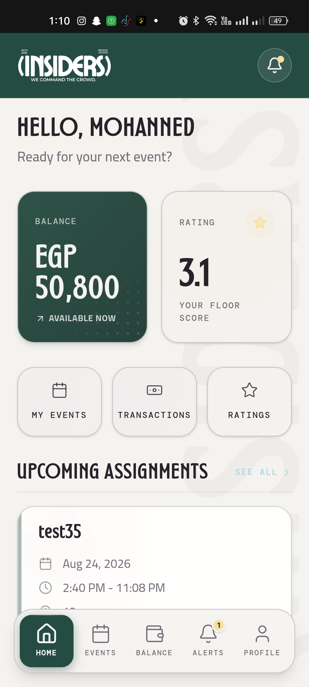
          </a>
        </td>
        <td align="center" width="33%">
          <a href="./readme-assets/my-events-usher.jpg" target="_blank" title="Click to view full uncompressed resolution">
            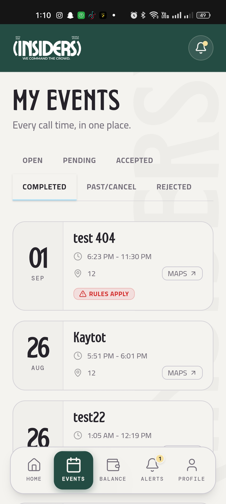
          </a>
        </td>
        <td align="center" width="33%">
          <a href="./readme-assets/my-profile.jpg" target="_blank" title="Click to view full uncompressed resolution">
            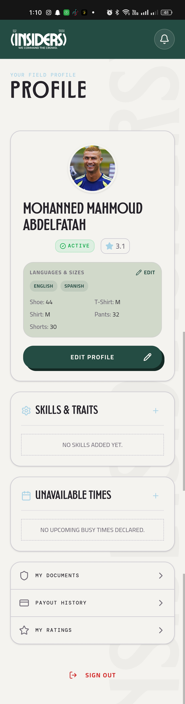
          </a>
        </td>
      </tr>
      <tr>
        <td align="center"><sub>Live wallet balance, ratings & upcoming call times</sub></td>
        <td align="center"><sub>Filtered shift pipeline with location maps & rule badges</sub></td>
        <td align="center"><sub>Uniform sizing (Pants 32, Shoes 44), languages & traits</sub></td>
      </tr>
    </tbody>
  </table>
</div>

---

### 2. Shift Discovery, Application & Completion Flow
- **Apply to Event:** Ushers browse open opportunities, review call times, hourly or daily rates, venue location, and tap **APPLY TO EVENT**.
- **Application Pending:** Transparent queue display informing the usher that their application is under review by event coordinators, with the option to withdraw.
- **Assignment Completed:** Post-event confirmation celebrating shift completion, automatically calculating punctuality ratings and transferring earnings to the digital wallet.

<div align="center">
  <table>
    <thead>
      <tr>
        <th align="center">📥 Open for Applications</th>
        <th align="center">⏳ Application Pending</th>
        <th align="center">✅ Assignment Completed</th>
      </tr>
    </thead>
    <tbody>
      <tr>
        <td align="center" width="33%">
          <a href="./readme-assets/apply-to-event-usher.jpg" target="_blank" title="Click to view full uncompressed resolution">
            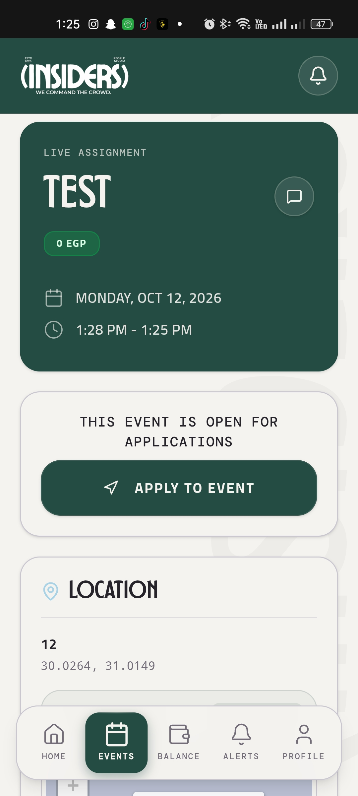
          </a>
        </td>
        <td align="center" width="33%">
          <a href="./readme-assets/application-pending-usher.jpg" target="_blank" title="Click to view full uncompressed resolution">
            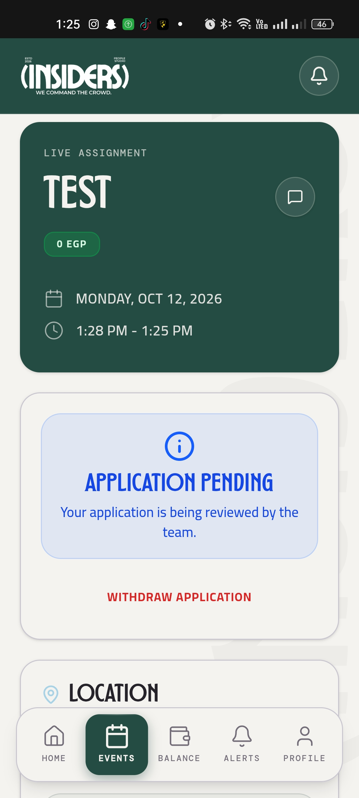
          </a>
        </td>
        <td align="center" width="33%">
          <a href="./readme-assets/event-done-usher.jpg" target="_blank" title="Click to view full uncompressed resolution">
            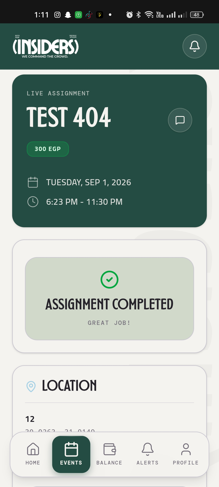
          </a>
        </td>
      </tr>
      <tr>
        <td align="center"><sub>Venue coordinates & 1-tap application trigger</sub></td>
        <td align="center"><sub>Real-time review status with withdraw option</sub></td>
        <td align="center"><sub>Shift wrap-up with automated punctuality feedback</sub></td>
      </tr>
    </tbody>
  </table>
</div>

---

### 3. Real-Time Alerts, Check-in & Earnings Ledger
- **Alerts Feed:** Consolidated notifications for admin chat announcements, direct shift assignments, onboarding approvals, and policy updates.
- **Alert Detail Modal:** Rich dialog offering granular shift assignment specifics before accepting or confirming attendance.
- **Earnings & Payout Requests:** Digital wallet ledger itemizing completed event earnings (e.g. `+EGP 250.00`) and a 1-tap **REQUEST PAYOUT** trigger.
- **GPS Check-in:** Geofence verification requiring staff to be within physical venue boundaries before shift commencement.

<div align="center">
  <table>
    <thead>
      <tr>
        <th align="center">🔔 In-App Alerts Feed</th>
        <th align="center">📋 Alert Details Dialog</th>
        <th align="center">💰 Balance & Ledger</th>
        <th align="center">📍 GPS Check-in</th>
      </tr>
    </thead>
    <tbody>
      <tr>
        <td align="center" width="25%">
          <a href="./readme-assets/alerts-tab-usher.jpg" target="_blank" title="Click to view full uncompressed resolution">
            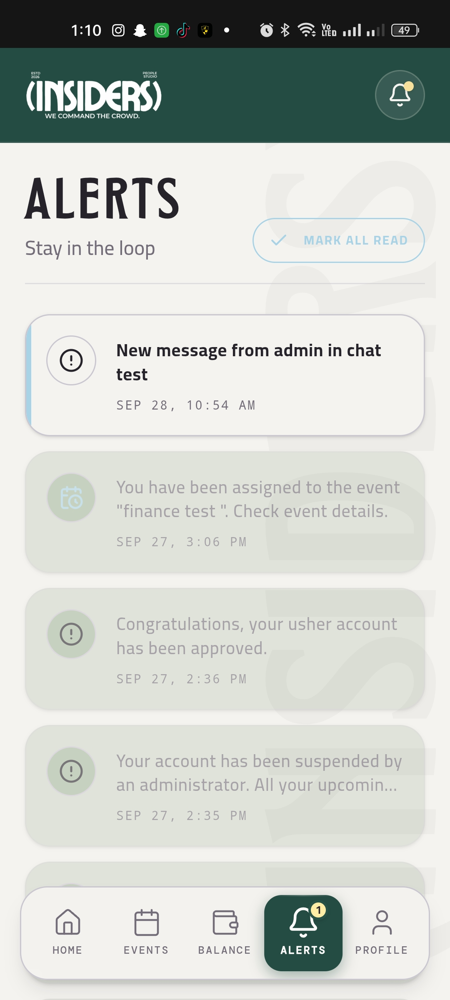
          </a>
        </td>
        <td align="center" width="25%">
          <a href="./readme-assets/message-opend.jpg" target="_blank" title="Click to view full uncompressed resolution">
            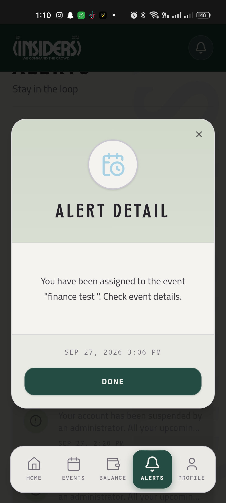
          </a>
        </td>
        <td align="center" width="25%">
          <a href="./readme-assets/balance-usher.jpg" target="_blank" title="Click to view full uncompressed resolution">
            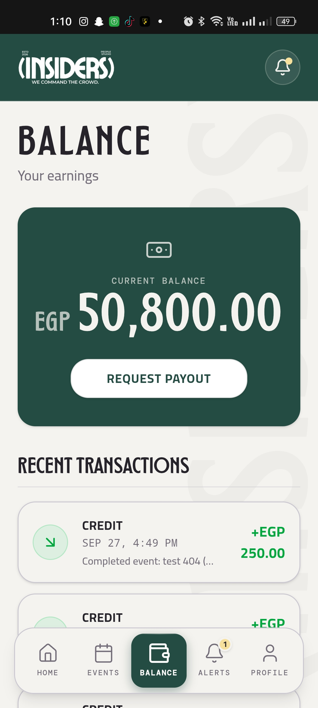
          </a>
        </td>
        <td align="center" width="25%">
          <a href="./readme-assets/checkin-screen.png" target="_blank" title="Click to view full uncompressed resolution">
            
          </a>
        </td>
      </tr>
      <tr>
        <td align="center"><sub>Consolidated push stream</sub></td>
        <td align="center"><sub>Event assignment details</sub></td>
        <td align="center"><sub>Transparent transaction credits</sub></td>
        <td align="center"><sub>Geofenced verification</sub></td>
      </tr>
    </tbody>
  </table>
</div>

---

## 💻 The Admin Operations Command Center

The Admin Operations Hub is the desktop-ready control center for event directors, floor coordinators, and finance managers.

### 1. Live Command Dashboard & Key Metrics
High-level overview displaying active events, confirmed staff count, check-in completion percentages, 6-month event trends (Total vs. Completed), and platform health indicators.

<div align="center">
  <a href="./readme-assets/admin-dashboard.png" target="_blank" title="Click to view full-resolution screenshot">
    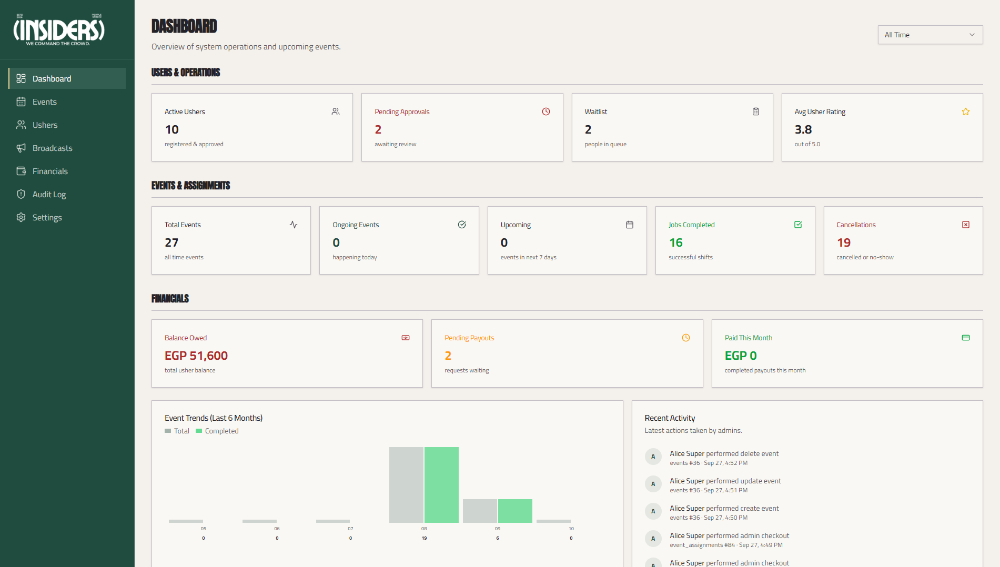
  </a>
</div>

---

### 2. Event Creation & Intelligent Venue Geofencing
Creating an event integrates high-precision mapping and logistical parameters:
- **LocationIQ Autocomplete & Popular Venues:** Search venues across Egypt or pick from popular locations (*Cairo International Convention Centre, El Gouna Arena, EIEC, The Grand Egyptian Museum, New Capital Sports City*).
- **Interactive Leaflet Map & Range Presets:** Draggable pins with live geofence radius presets (*50m, 100m, 150m, 250m, 500m, 1000m*).
- **Arrival Windows:** Configure early arrival allowance (*e.g., Check-in opens 5 minutes before call time*).

<div align="center">
  <a href="./readme-assets/new-event1.png" target="_blank" title="Click to view full-resolution screenshot">
    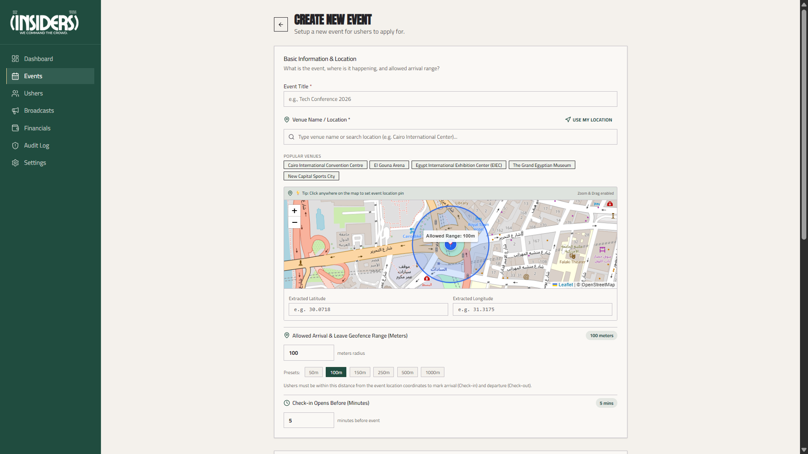
  </a>
</div>

---

### 3. Multi-Day Event Overview & Schedule Configuration
Full configuration of multi-day shift logistics, compensation tiers, and attire guidelines:
- **Schedule:** Independent Start and End dates and times supporting single-day and multi-day operations.
- **Rate Differentiation:** Distinct pay scales for **Team Leads** (e.g. `EGP 1,100/day`) versus **Regular Ushers** (e.g. `EGP 1,000/day`), automatically calculating cumulative multi-day totals (`EGP 1,100 × 7 = EGP 7,700`).
- **Dress Code & Instructions:** Granular uniform instructions (e.g. *"Black Suit, White shirt, Black Shoes (No Tuxedos, No Oversized Pants)"*).
- **Real-Time Attendance Overview:** Instant headcount cards for Assigned Staff, Checked In, Pending Applicants, and Late / No-Show counts.

<div align="center">
  <a href="./readme-assets/new-event2.png" target="_blank" title="Click to view full-resolution screenshot">
    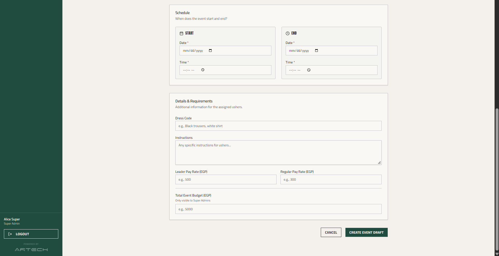
  </a>
</div>

<br/>

<div align="center">
  <a href="./readme-assets/event-overview.png" target="_blank" title="Click to view full-resolution screenshot">
    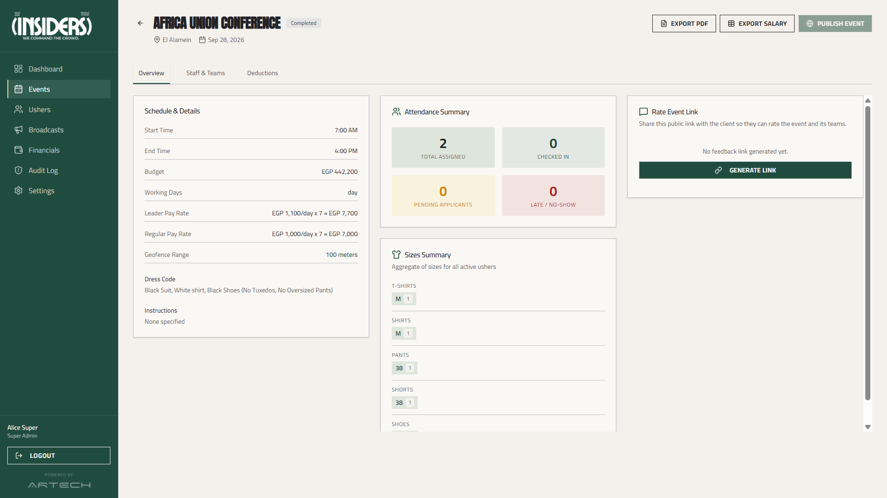
  </a>
</div>

---

### 4. Operational Teams, Staff Allocation & Applicant Filters
Complex events require multi-zone team structuring and fine-grained applicant screening:
- **Zoned Teams:** Organize personnel by location or operational responsibility (e.g. *Cairo Airport*, *Alamein Venue*, *VIP Stage*).
- **Staff Roster Actions:** Real-time visibility into assigned staff with one-click actions: **RATE**, **DEDUCT**, and **REMOVE**.
- **Smart Applicant Filtering:** Filter pending applicants by *Gender*, *Language*, *Minimum Rating*, *Height (cm)*, *Dress Size*, and *Shoe Size*.

<div align="center">
  <a href="./readme-assets/all-events.png" target="_blank" title="Click to view full-resolution screenshot">
    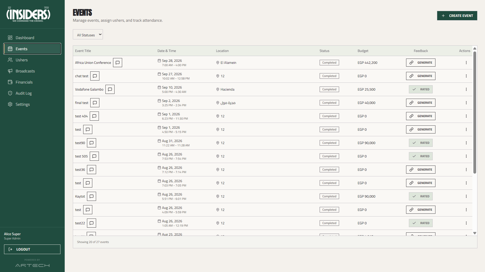
  </a>
</div>

<br/>

<div align="center">
  <a href="./readme-assets/event-staff-and-teams.png" target="_blank" title="Click to view full-resolution screenshot">
    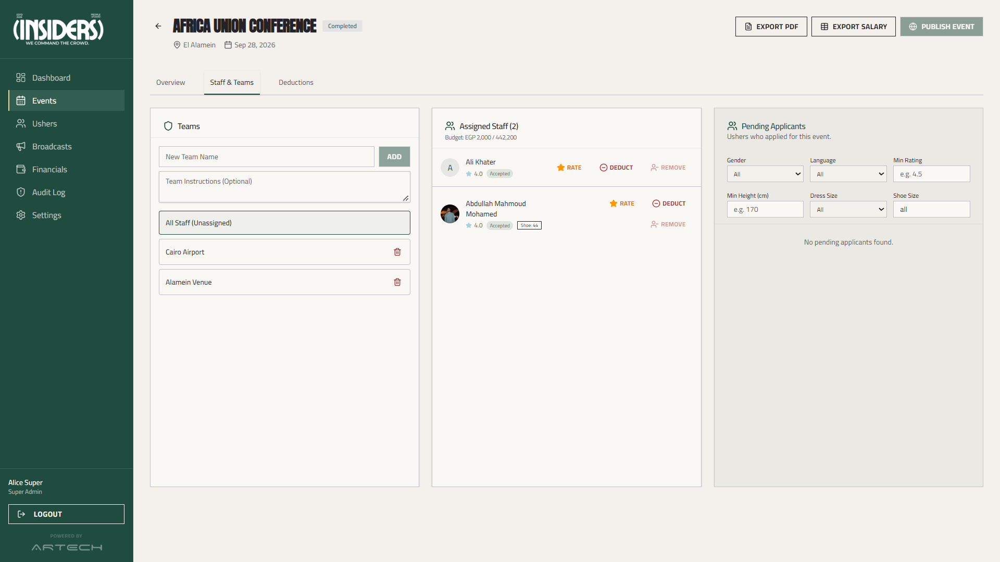
  </a>
</div>

<br/>

<div align="center">
  <a href="./readme-assets/account-approval.png" target="_blank" title="Click to view full-resolution screenshot">
    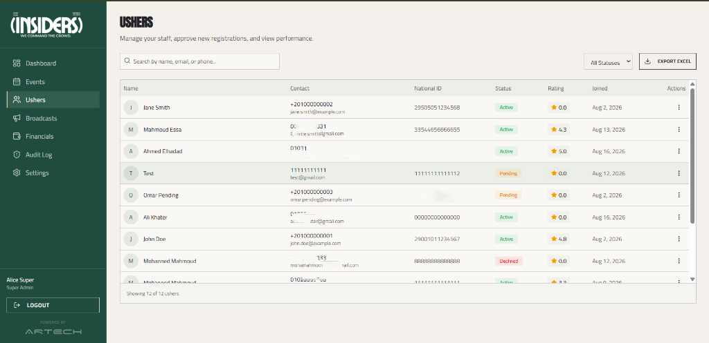
  </a>
</div>

---

### 5. Dual-Factor Attendance Audit & Live Selfie Verification
Eliminates fraudulent attendance through verifiable biometric and spatial proofs:
- **Check-in Details Modal:** Inspect any assigned staff member's exact check-in and checkout timestamps, late arrival duration (e.g. `0 mins`), and early leave status.
- **Selfie / Proof Verification:** View the high-resolution live selfie taken by the usher at the moment of check-in, verifying their physical presence, location, and proper dress code compliance.

<div align="center">
  <a href="./readme-assets/checkin-details-modal.png" target="_blank" title="Click to view full-resolution screenshot">
    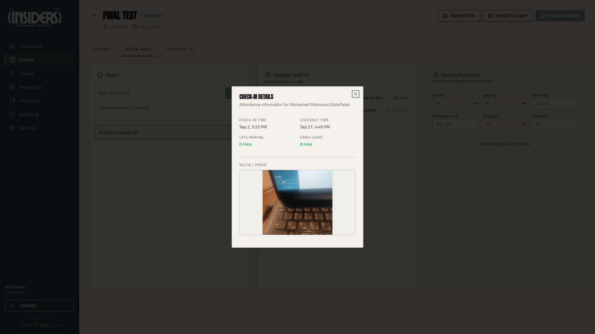
  </a>
</div>

---

### 6. Real-Time Event Announcements & Broadcast Streams
Dedicated communication feeds that keep coordinators and on-ground personnel synchronized:
- **Event Announcements:** Broadcast shift updates, gate changes, and security protocols directly to all assigned staff for a specific event.
- **FCM Push Notifications:** Urgent announcements trigger instant lock-screen push alerts on ushers' mobile devices.

<div align="center">
  <a href="./readme-assets/event-chat.png" target="_blank" title="Click to view full-resolution screenshot">
    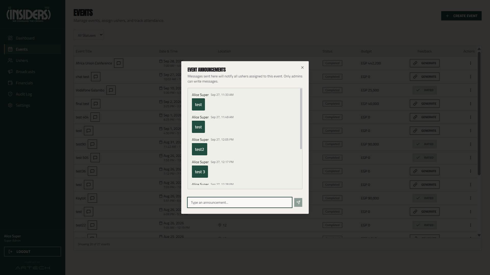
  </a>
</div>

<br/>

<div align="center">
  <a href="./readme-assets/broadcasts-screen.png" target="_blank" title="Click to view full-resolution screenshot">
    
  </a>
</div>

---

### 7. Apparel & Uniform Logistics (Automated Sizes Summary)
Uniform distribution is automated directly from usher profile data:
- **Sizes Summary Card:** The event overview automatically calculates the total aggregate uniform requirements of all assigned ushers (e.g. *T-Shirts: M (1), Shirts: M (1), Pants: 38 (1), Shorts: 38 (1), Shoes: 44 (1)*).
- **Roster Export Integration:** Sizing tallies are embedded into exported PDF sheets for immediate distribution by wardrobe and warehouse teams.

---

### 8. Smart Deduction Engine & Lateness Matrix
Admins have granular control over punctuality and attendance policies:
- **Configurable Rules:** Define flat or progressive penalties (e.g. `-50 EGP` flat late deduction applied automatically at checkout).
- **Rule Triggers:** Set condition triggers (*Always Apply*, *Lateness Grace Period*, *Dress Code Infraction*).
- **Total Deduction Banner:** Live banner tracking total deductions applied across all ushers in the shift.

<div align="center">
  <a href="./readme-assets/deduction-rules.png" target="_blank" title="Click to view full-resolution screenshot">
    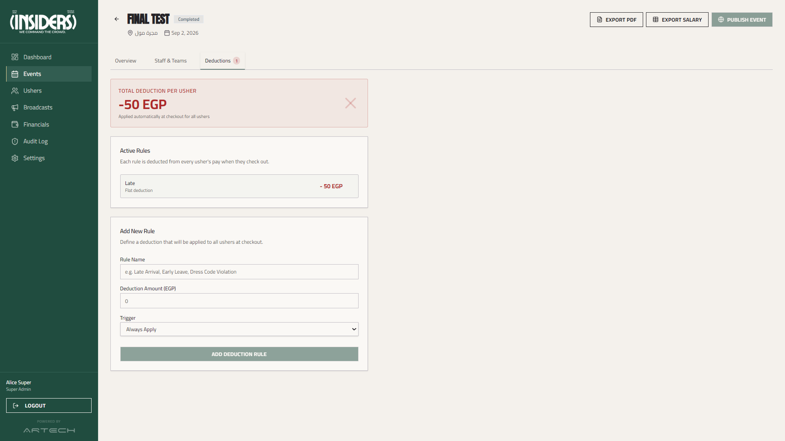
  </a>
</div>

---

### 9. Disciplinary Suspension Engine & Quick-Select Presets
Enforces reliability with automated and manual suspension options:
- **Quick-Select Presets:** Suspend unreliable staff with 1-click presets: **1 Week**, **2 Weeks**, **1 Month**, **3 Months**, **6 Months**, or **1 Year**.
- **Custom Date Picker:** Set custom suspension expiration dates and times.
- **Automated Revocation:** Suspending an usher automatically cancels all their upcoming event assignments and restricts them from applying to new shifts.

<div align="center">
  <a href="./readme-assets/suspension-dialog.png" target="_blank" title="Click to view full-resolution screenshot">
    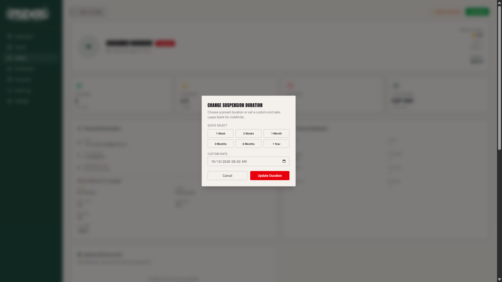
  </a>
</div>

---

### 10. Executive Financial Suite & Branded Excel Payroll Export
Seamless financial oversight with one-click publication-ready payroll sheets:
- **Insiders Branded Excel Sheet:** Generated via ExcelJS with Navy (`#00003087`) and Teal (`#0070C0`) styling matching the brand manual.
- **Section Separation:** Automatically divides staff into **Supervisors** and **Ushers**, computing days worked, daily rate, deductions, subtotals, and net totals.
- **InstaPay Integration:** Embeds direct InstaPay links for rapid digital batch transfers.

<div align="center">
  <a href="./readme-assets/salary-sheet-excel.png" target="_blank" title="Click to view full-resolution screenshot">
    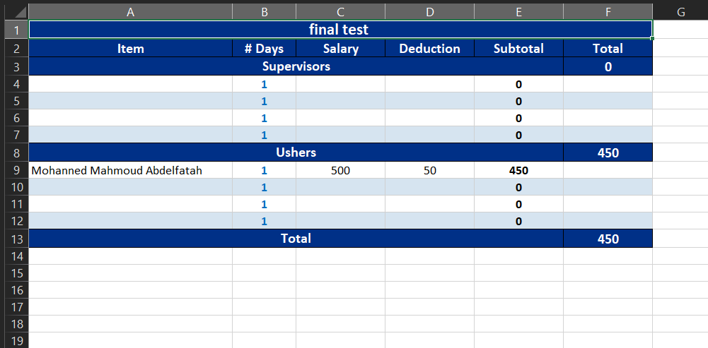
  </a>
</div>

---

### 11. Printable Event Ushers Sheet (High-Resolution PDF)
High-fidelity on-ground attendance roster generated dynamically:
- **Enlarged High-Clarity Photos:** High-resolution portrait photos (`144px × 144px`) rendered with 2.5× DPI canvas export for razor-sharp physical identification.
- **Operational Data:** Full name, operational team (*Cairo Airport*, *Alamein Venue*), role (*Team Lead*, *Regular*), and a blank signature/notes column for physical check-in.
- **Sizes Summary:** Embedded breakdown of all uniform sizes on the roster sheet.

<div align="center">
  <a href="./readme-assets/ushers-sheet-pdf.png" target="_blank" title="Click to view full-resolution screenshot">
    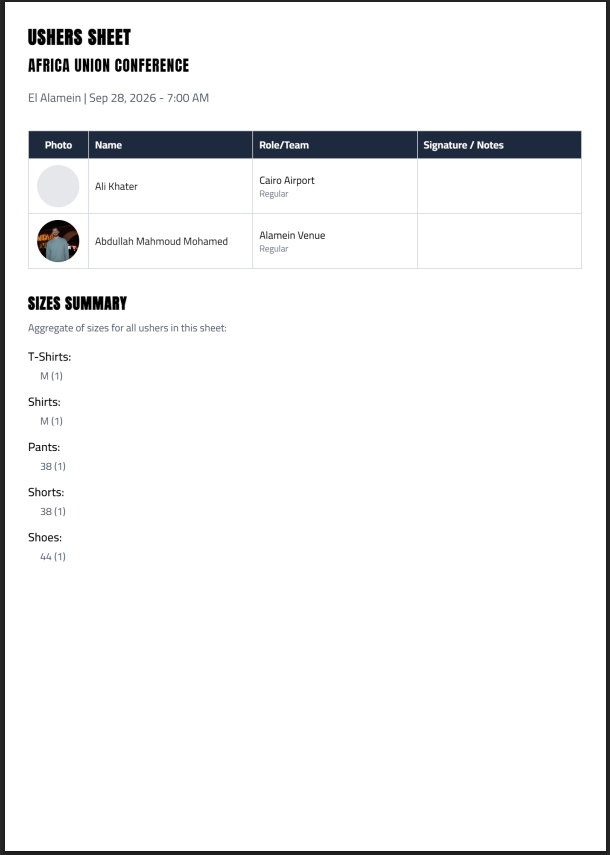
  </a>
</div>

---

### 12. Immutable System Audit Log
Every critical administrative action—application approval, salary adjustment, manual check-in override, or suspension—is logged with immutable timestamps, admin identities, and action parameters.

<div align="center">
  <a href="./readme-assets/audit-log.png" target="_blank" title="Click to view full-resolution screenshot">
    
  </a>
</div>

<br/>

<div align="center">
  <a href="./readme-assets/ratings-feedback.png" target="_blank" title="Click to view full-resolution screenshot">
    
  </a>
</div>

---

## End-to-End Operational Workflows

### The Usher's Experience
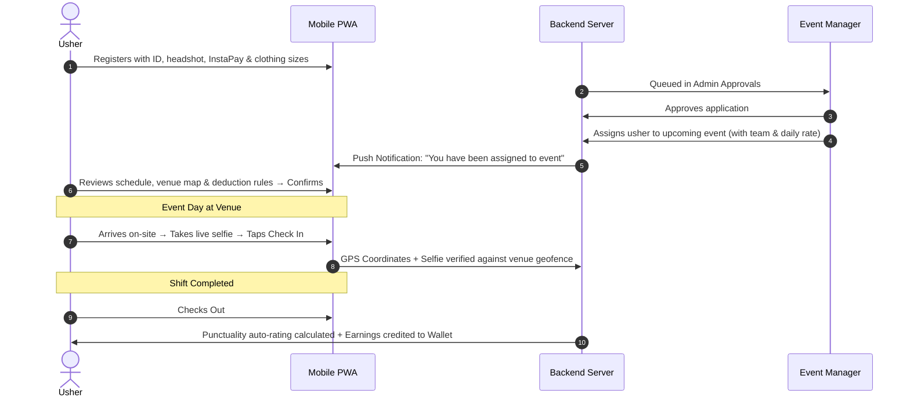

### The Event Organizer's Workflow
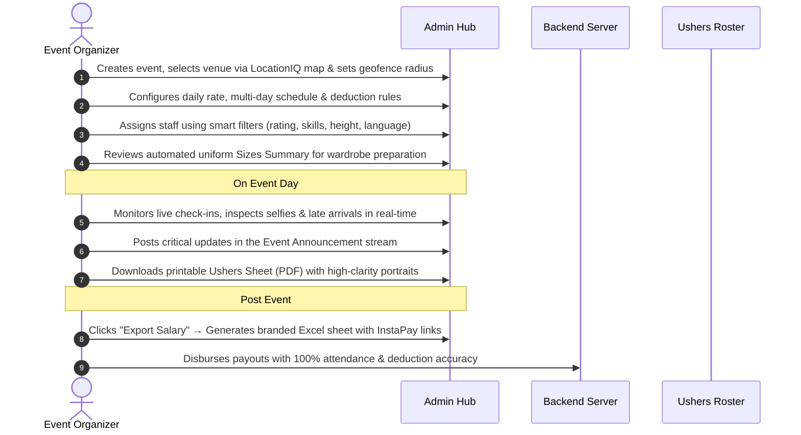

---

## Branding & Visual Philosophy

INSIDERS follows a visual philosophy of **Authority, Professionalism, and Clean Elegance**:
- **Monochrome & Deep Navy Canvas:** Sleek high-contrast dark interface accented with Navy (`#00003087`) and Electric Teal (`#0070C0`).
- **Typography:** Modern, legible sans-serif hierarchy tailored for rapid scanning under intense event conditions.
- **Micro-Interactions:** Subtle status badges, smooth drawer transitions, and responsive feedback indicators across both mobile PWA and desktop panels.

<div align="center">
  <a href="./readme-assets/branding-overview.png" target="_blank" title="Click to view full-resolution screenshot">
    
  </a>
</div>

---

<div align="center">
  <sub>Designed and engineered for high-performance event operations. © INSIDERS. All rights reserved.</sub>
</div>
